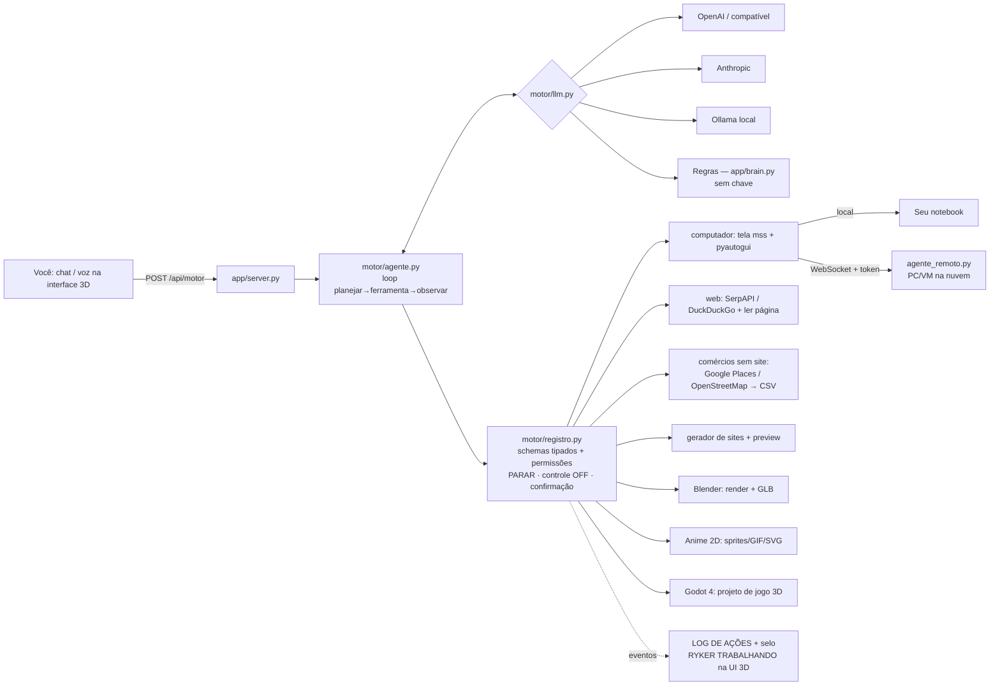

# ⚙️ Motor do Jarvis/Ryker — a "engrenagem" em Python

O motor é o **cérebro com ferramentas** do Ryker. Você pede em português, ele **planeja → chama uma ferramenta → observa o resultado → repete**, até terminar. Funciona com **OpenAI (ou qualquer API compatível)**, **Anthropic** ou **Ollama local**. Sem nenhuma chave, ele usa o **parser de regras** (`app/brain.py`) e continua funcionando.

## Arquitetura



| Arquivo | Função |
|---|---|
| `agente.py` | Loop do agente (até 12 passos). Resultados com imagem vão para o modelo de visão. |
| `llm.py` | Provedores com a mesma interface `pensar(mensagens, ferramentas)` e *tool calling* nativo. |
| `registro.py` | `@ferramenta(risco=...)`: gera o JSON Schema a partir dos *type hints* e aplica a segurança em um só lugar. |
| `agente_remoto.py` | Servidor WebSocket que roda **no outro computador/VM**, com a mesma API de tela/ações. |
| `ferramentas/computador.py` | `tela_capturar`, `computador_clicar/digitar/teclas/acao`, `computador_alvo` (local ou remoto). |
| `ferramentas/web.py` | `pesquisar_web`, `ler_pagina`. |
| `ferramentas/comercios.py` | `buscar_comercios_sem_site(cidade, categoria)` → CSV (`;`, abre no Excel). |
| `ferramentas/sites.py` | `gerar_site(...)`: site responsivo e interativo (WhatsApp, cardápio com filtro, depoimentos, horário com "aberto agora", mapa, SEO JSON-LD), `site_preview`. |
| `ferramentas/blender.py` + `modelos/blender_anime.py` | Cena anime toon (Cycles + Freestyle) → `render.png`, `cena.glb`, `cena.blend`; `blender_executar_script` (pede confirmação). |
| `ferramentas/anime2d.py` | `anime2d_sprites` (quadros PNG, sprite sheet, GIF), `anime2d_svg` (SVG animado pelo LLM ou modelo). |
| `ferramentas/godot.py` | `criar_jogo_godot`: jogo 3D em 3ª pessoa (WASD, pulo, câmera com mouse, moedas, placar), valida em modo headless e exporta se houver *export templates*. |

## Segurança (igual à v4)
- **Controle do PC começa DESLIGADO.** Ferramentas de `risco` (clicar, digitar, teclas) são recusadas até você ligar no botão do HUD.
- **PARAR** (botão, Esc×3, mouse no canto) também bloqueia **todas** as ferramentas do motor até você religar.
- `blender_executar_script` (código arbitrário) exige confirmação.
- Argumentos desconhecidos ou faltando são recusados, para que o LLM não "invente" parâmetros.
- O `agente_remoto` exige token (≥12 caracteres), escuta só em `127.0.0.1` por padrão e **não aceita ligar o controle pela rede** sem `--permitir`.
- O motor **não envia** e-mails nem mensagens e não publica nada.

## Chaves / variáveis de ambiente (todas opcionais)
| Variável | Para quê |
|---|---|
| `OPENAI_API_KEY`, `OPENAI_BASE_URL`, `OPENAI_MODEL` | LLM OpenAI ou compatível (Groq, OpenRouter, xAI…). Padrão `gpt-4o-mini`. |
| `ANTHROPIC_API_KEY`, `ANTHROPIC_MODEL` | Claude. |
| `OLLAMA_HOST`, `OLLAMA_MODEL` | LLM local (ex.: `llama3.1`, ou `llava` para visão). |
| `JARVIS_LLM` | Força um provedor: `openai`, `anthropic`, `ollama` ou `regras`. |
| `SERPAPI_KEY` | Resultados do Google de verdade (sem a chave, usa DuckDuckGo). |
| `GOOGLE_MAPS_API_KEY` | Google Places (sem a chave, usa OpenStreetMap, grátis). |
| `JARVIS_RAIO_M` | Raio da busca no OSM (padrão 12000 m). |
| `JARVIS_REMOTO_TOKEN` | Segredo do agente remoto. |
| `BLENDER_BIN`, `GODOT_BIN` | Caminhos dos programas, se não estiverem no PATH. |
| `JARVIS_SAIDAS` | Pasta de saída (padrão `motor/saidas`). |

## Como usar
```bash
pip install fastapi uvicorn mss pillow pyautogui websockets playwright
python run.py                      # interface 3D: marque "Motor do agente" e peça no chat
# exemplos de pedidos:
#  "comércios sem site de padarias em Boa Vista"
#  "cria um jogo 3d no godot"       "faz um anime 2d"       "faz um anime 3d no blender"
#  "pesquisa melhores padarias boa vista"     "clica no botão iniciar" (só com o controle LIGADO)
python -m unittest discover -s motor/testes -t .     # testes
```
**Computador na nuvem:** na VM, rode `JARVIS_REMOTO_TOKEN=segredo-bem-longo python -m motor.agente_remoto --host 0.0.0.0 --porta 8765` (de preferência por um túnel SSH ou VPN, nunca exposto aberto). Depois peça ao Ryker para usar `ws://IP:8765` como alvo.

## Demos geradas (`motor/saidas/`)
- `comercios/boa-vista_padarias_sem_site.csv`: 22 padarias do OSM, 21 sem site.
- `sites/pedacinho-do-ceu/`: site completo, com `screenshot_desktop.png` e `screenshot_celular.png`.
- `blender/ryker/`: `render.png` e `cena.glb` (o `.blend` fica fora do zip).
- `anime2d/ryker/`: `spritesheet.png`, `animacao.gif` e 12 quadros; `anime2d/svg-anime.svg`.
- `godot/ryker-coleta/`: projeto Godot 4.3, importado e executado em modo headless sem erros.

## Limitações
- Sem chave de LLM, o modo regras entende frases simples. Planejamento de verdade, visão e textos de site personalizados precisam de uma chave.
- No OSM, "sem site" quer dizer "sem site cadastrado no OSM". Use `verificar_web=true` ou Google Places para confirmar, e os telefones costumam faltar.
- A exportação do Godot precisa dos *export templates* (cerca de 1 GB, instale pelo editor). O projeto é gerado e validado sem eles.
- O atalho global Ctrl+Alt+Q precisa de `pynput` (no Linux use o botão PARAR).
